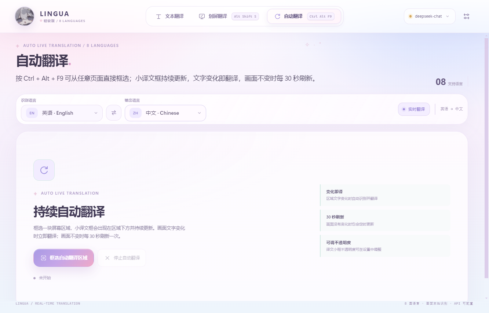
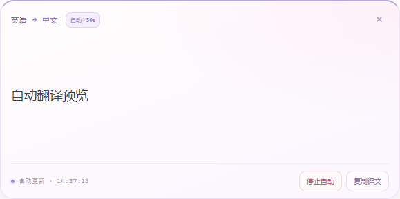
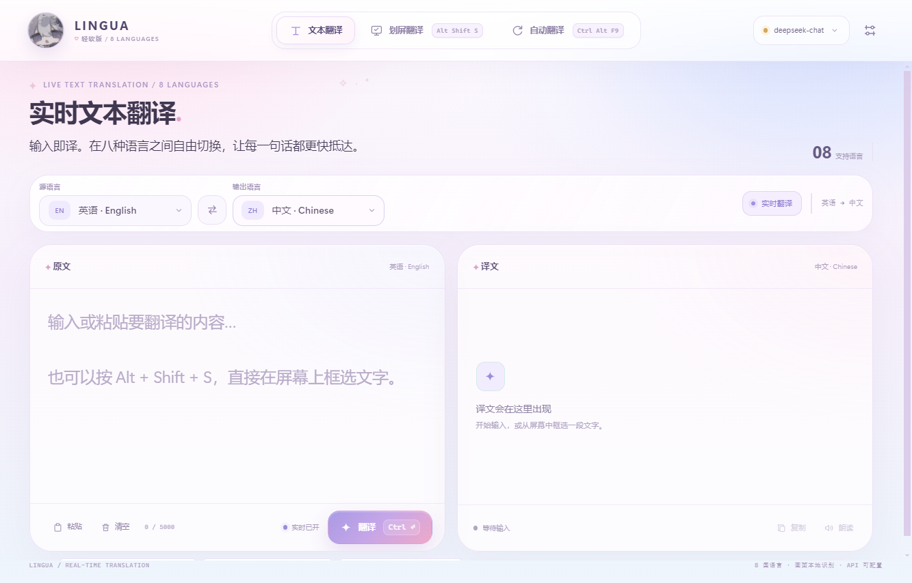
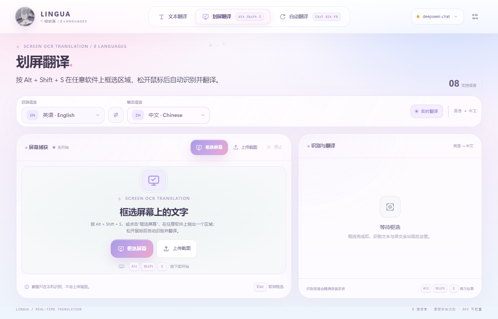

# LINGUA · 实时翻译

支持 **8 国语言 + 自动检测**、输入即译、**Ctrl + Shift + F2 全局快捷键划屏**、屏幕框选 OCR 翻译，以及**持续自动翻译**：框选一块区域后，画面文字变化时自动更新译文，画面不变时每 30 秒刷新一次。桌面版采用**浅色极简界面 + 紧凑窗口**，框选结束后不弹出主界面，译文浮层直接显示在框选区域下方。划屏和自动翻译**各有一个独立全局快捷键**，都可以在设置中修改。






## 桌面版（推荐）

双击 **`D:\LINGUA\LINGUA.exe`**，或使用桌面上的 **“LINGUA 实时翻译”** 快捷方式。

桌面版已经打包好 Electron 运行环境：

- 不需要 Python、不需要浏览器标签页；
- **Ctrl + Shift + F2 是系统级全局快捷键**，在任意软件上都可以框选取词；
- 点击窗口 X 会隐藏到系统托盘，后台继续运行；
- 原生桌面框选，不经过浏览器屏幕共享授权；
- **框选后不弹出主界面**：译文按识别到的文本位置，分别显示在对应原文的下方，原文仍留在屏幕上；按 `Esc` 退出；
- 截图只在本地识别，不上传画面。

> 桌面版文件夹请保持在纯英文路径（当前为 `D:\LINGUA`）。由于 Electron 运行环境限制，不要把 `LINGUA.exe` 单独移到中文路径；整个 `LINGUA` 文件夹可以整体复制。

> 应用未进行代码签名，首次启动时 Windows 可能提示“未知发布者”。点击“更多信息 → 仍要运行”即可。

桌面版说明也放在 `D:\LINGUA\使用说明.txt`。

## 功能

- **8 国语言 + 自动检测**：中文、英语、日语、韩语、法语、德语、西班牙语、俄语；源语言可设为“自动检测”，输出语言自由选择。
- **实时文本翻译**：开启“实时翻译”后，停止输入约 0.65 秒自动翻译；也可 `Ctrl + Enter` 手动翻译。
- **全局快捷键划屏**：按划屏快捷键（默认 `Ctrl + Shift + F2`），在任意软件界面拖出矩形区域，松开鼠标后自动 OCR、识别语言并翻译。
- **持续自动翻译**：使用独立的自动翻译快捷键（默认候选 `Ctrl + Alt + A`，被占用时自动选择可用组合，也可在设置中修改），框选一块区域后，小译文框会持续跟随画面更新；文字变化立即翻译，画面不变时每 30 秒刷新一次。
- **原位译文**：划屏后不弹出结果卡片；OCR 返回文本块坐标，译文分别显示在屏幕上对应原文的下方。布局会自动避让原文框、其他译文标签和 Esc 提示条，确保互不重叠；句子较多时页面会自动延长，可滚动查看全部译文。按 `Esc` 退出；自动翻译仍使用独立小浮层。
- **本地 OCR**：使用 Tesseract.js 在本机识别文字；桌面版内置 8 种语言的 OCR 模型；截图不上传，只有识别出的文字发送给翻译 API。
- **截图上传**：也可以上传本地截图后框选识别。
- **轻软界面**：薰衣草、樱粉与月光蓝配色，圆角卡片、柔和光晕和圆形角色图标；主界面、设置、划屏覆盖层与译文浮层统一风格。
- **启动免责声明**：每次启动显示使用声明；可勾选“不再显示”永久关闭，偏好只保存在本机。
- **模式切换动画**：文本翻译、划屏翻译、自动翻译之间切换时，面板和标题会柔和滑动淡入，标签页有弹性反馈。
- **双引擎 API**：
  - 默认 **MyMemory** 免费公共接口，无需 API Key，打开即用；
  - 可切换任意 **OpenAI 兼容 API**（DeepSeek、OpenAI、OpenRouter、本地 Ollama 等），支持流式输出。
- **设置中心**：可以修改划屏全局快捷键、切换翻译引擎、填写/测试 API；设置和 API Key 会保存在本机，重启后自动恢复。
- **桌面能力**：浅色极简界面、紧凑主窗口、系统托盘、全局热键、原生框选遮罩、后台运行。
- **复制 / 朗读 / 示例 / 快捷键**，桌面端与移动端自适应布局。

## 桌面版使用方式

1. 启动 `LINGUA.exe`（或桌面快捷方式）。
2. 在顶部选择源语言；默认就是“自动检测”。再选择输出语言。
3. 按 `Ctrl + Shift + F2`，或点击“框选屏幕”。
4. 屏幕会冻结并变暗；按住鼠标拖出一个矩形，松开后自动识别、检测语言并翻译。
5. **主界面不会弹出**。截图会冻结在屏幕上，译文按识别到的文本块位置显示在对应原文下方；不同位置的句子分别显示。按 `Esc` 退出。
6. 如需调整识别/输出语言或查看详细文本，右键托盘图标打开主界面。
7. 点击右上角 **设置** 按钮，可修改划屏快捷键、配置 API 和检查 API Key 记忆状态。
8. 切换到 **自动翻译** 页，可开始持续区域翻译。

关闭窗口时，LINGUA 会隐藏到系统托盘。右键托盘图标可以打开主界面、开始划屏或退出。

桌面版内置 8 种语言的 OCR 模型。首次使用“自动检测”时需要初始化多语言模型，可能稍慢；启动后会在后台预热，之后会很快。主界面里也可以手动编辑识别文本后重新翻译。

## 自动翻译（持续区域）

1. 点击顶部 **自动翻译** 标签。
2. 点击 **框选自动翻译区域**，拖动鼠标选出需要持续关注的屏幕区域；也可以直接按自动翻译快捷键。
3. 主界面会隐藏，小译文框出现在区域下方；画面文字变化时会自动识别并翻译。
4. 如果画面文字没有变化，也会每 30 秒重新翻译一次。
5. 点击小译文框的关闭按钮或“停止自动”即可停止监控；也可以回到主界面的自动翻译页点击“停止自动翻译”。

小译文框默认 80% 不透明度，可在设置中分别调整划屏/自动翻译的透明度；按住小框任意空白处即可拖动到别的位置。自动翻译有独立全局快捷键，在任意页面都可以直接开始；划屏快捷键始终执行一次划屏，两者互不影响。

## 设置与快捷键

点击右上角设置（齿轮）按钮：

- **划屏快捷键**：点击“修改快捷键”，直接按下新的组合键，例如 `Ctrl + Alt + K` 或 `Ctrl + Shift + F8`。组合键需要包含 `Ctrl`、`Alt` 或 `Win`，按 `Esc` 取消。设置立即生效，并会在下次启动时恢复。
- **自动翻译快捷键**：同一套修改方式，独立于划屏快捷键。默认候选为 `Ctrl + Alt + A`；如果被系统或其他软件占用，会自动选择可用组合（本机可在设置/顶部自动翻译标签查看当前值）。
- **译文/提示不透明度**：划屏滑杆同时控制原位译文标签、状态提示和 Esc 关闭提示条；自动翻译滑杆控制自动翻译小浮层。可在 20%–100% 之间调整，数值越低越透明，保存后生效。
- **翻译引擎**：在 MyMemory 与 OpenAI 兼容 API 之间切换。
- **API Key 记忆**：勾选“在本机记住 API Key”后，密钥会保存到本机应用数据目录，重启软件后会自动填入。桌面版使用固定本地端口，并额外写入 `%APPDATA%\LINGUA\settings.json`，因此不会因为随机端口变化而丢失。
- 未勾选“记住 API Key”时，密钥只存在于当前运行会话；重启后需要重新输入。

> 旧版本曾使用随机端口，可能导致 API Key 无法跨启动保存。更新后重新输入一次即可长期保留。

## 配置 API

点击右上角 API 状态或设置按钮。

### MyMemory（默认）

无需配置即可使用。可选填联系邮箱以提升免费额度。

MyMemory 是公共免费接口，存在每日额度与速率限制，不适合翻译敏感内容。

### OpenAI 兼容 API

填写：

- **接口地址**：例如 `https://api.deepseek.com/v1/chat/completions`
- **模型**：例如 `deepseek-chat`、`gpt-4o-mini`
- **API Key**：勾选“在本机记住 API Key”，会保存在本机应用数据中，重启后自动填入
- 流式输出开关

内置快速填充：DeepSeek、OpenAI、OpenRouter、本地模型。也支持本地 Ollama：

```text
http://127.0.0.1:11434/v1/chat/completions
```

点击“测试连接”可以验证接口、模型和密钥。桌面版和网页版都通过本机代理转发请求，避免浏览器 CORS 问题。

## 快捷键

| 快捷键 | 功能 |
| --- | --- |
| `Ctrl + Shift + F2` | 默认划屏快捷键（一次划屏；桌面版可在设置中修改） |
| `Ctrl + Alt + A` | 自动翻译默认候选快捷键（被占用时自动选择可用组合；可在设置中修改） |
| `Ctrl + Enter` | 在文本输入框中立即翻译 |
| `Esc` | 取消当前框选 / 关闭设置 |

网页版受浏览器限制，无法注册系统级全局热键，快捷键需在 LINGUA 页面聚焦时使用。桌面版没有这个限制，并且可以在设置中改成任意可用组合键。

## 网页版（开发/备用）

如果暂时不运行桌面版，也可以使用原来的网页版：

双击 **`启动翻译工具.bat`**，它会启动本地 Python 服务并打开：

```text
http://127.0.0.1:8787/
```

> 网页版屏幕共享需要 `http://127.0.0.1` 安全上下文，不建议直接打开 `index.html`。





如果端口 8787 被占用：

```bat
python server.py --port 8790
```

然后打开 `http://127.0.0.1:8790/`。

## 隐私说明

- 屏幕画面只在本机浏览器/桌面进程内截取和 OCR，**不会上传画面**。
- 识别出的文字会发送到你选择的翻译 API（MyMemory 或自定义 OpenAI 兼容接口）。
- API Key 只保存在本机应用数据目录/浏览器存储，本机代理不持久化 Key。
- 如翻译内容敏感，请使用自建/本地模型，并阅读对应服务隐私政策。

## 目录

```text
translation-tool/
├─ index.html               # 网页版和桌面版共用的界面
├─ styles.css
├─ app.js
├─ server.py                # 网页版本地代理（Python 标准库）
├─ 启动翻译工具.bat          # 网页版启动器
├─ preview*.png
├─ README.md
└─ desktop/                 # 桌面版源码
   ├─ main.js               # Electron 主进程、全局热键、原生框选、托盘
   ├─ preload.js
   ├─ overlay.html          # 全屏框选遮罩
   ├─ overlay-preload.js
   ├─ server.js             # 桌面版内置 API 代理
   ├─ package.json
   └─ assets/               # 应用图标
```

桌面版最终可执行文件位于：

```text
D:\LINGUA\LINGUA.exe
```

## 常见问题

**桌面版窗口关闭后去哪里了？**

它隐藏到了系统托盘。右键任务栏托盘中的 LINGUA 图标，可以打开主界面或退出。

**桌面版移动后打不开？**

请保持 `LINGUA` 整个文件夹完整，并放在纯英文路径。当前可用位置为 `D:\LINGUA`。

**快捷键无效或冲突？**

打开设置，点击“修改快捷键”，直接按下新的组合键即可。应用会测试组合键是否被占用；注册失败会提示换一个。请确认 LINGUA 正在运行（可以在托盘看到图标）。网页版仅在页面聚焦时生效。

**重启后 API Key 不见了？**

请确认设置中勾选了“在本机记住 API Key”，然后重新保存一次。此版本使用固定端口，并会把设置/密钥写入 `%APPDATA%\LINGUA\settings.json`，正常重启或强制结束进程后都能恢复。若关闭“记住”选项，密钥只保留在当前会话。

**OCR 很慢或失败？**

桌面版已内置 8 种 OCR 语言模型，首次自动识别时需要初始化多语言模型，稍等即可，之后会快很多。网页版首次识别某种语言时需要下载语言包。也可以缩小框选区域，或手动选择更精确的语言。

**翻译报错 401/403/429？**

- 401/403：检查 API Key、模型名和接口地址；
- 429：MyMemory 免费额度或自定义 API 速率限制；
- 在设置中点击“测试连接”查看详细错误。
